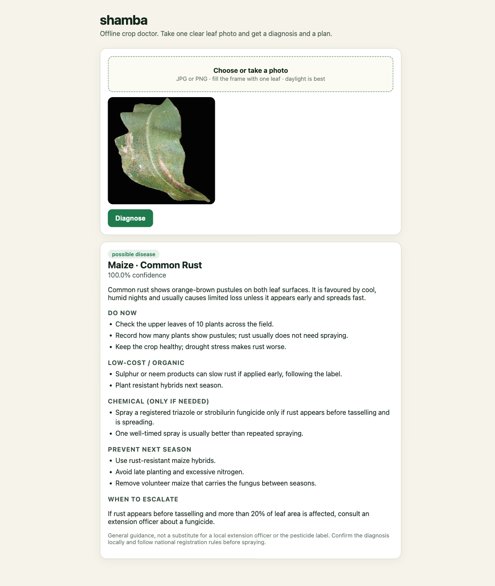

# shamba

[](https://github.com/iambiniyam/shamba/actions/workflows/ci.yml)
[](LICENSE)

A plant health scanner that runs offline.

Take one clear photo of a leaf. shamba returns the three most likely crop diseases, a confidence score, and a treatment plan. It runs on a laptop, a Raspberry Pi, or a Jetson. After setup, no internet connection is needed.



Status: v0.2.3. It works well on PlantVillage-style lab photos. Field photos are the next milestone.

## Why

See [how this compares](docs/comparison.md) with Plantix and PlantVillage Nuru.

Crop diseases cost farmers an estimated 30 to 40 percent of production each year. Home gardeners run into the same problems. Extension officers are spread thin, and a plant clinic visit can cost more than the plant is worth.

Most crop scanners send every photo to a paid API. shamba runs a small ONNX model on the device and pairs it with a local advice database. When the model is unsure, it says so and asks for a better photo.

## What it does

- Keeps a local, metadata-only history of recent diagnoses.
- Measures top-1 accuracy, ECE, Brier score, and per-class recall on a labeled local folder.

1. Diagnose: returns the top three crop and disease matches with confidence scores.
2. Explain: describes the disease and how it spreads.
3. Treat: starts with low-cost and organic options, and only mentions chemicals when they are likely needed.
4. Prevent: lists rotation, resistant varieties, sanitation, and watering practices.
5. Escalate: gives clear thresholds for calling a human extension officer.

## What is new in 0.2.0

- Rebuilt web interface with a phone camera first flow, drag and drop, paste, image preview, top-three cards, confidence bars, and a treatment plan.
- Automatic dark mode, keyboard access, loading states, error recovery, and mobile layouts.
- Added a 114-image held-out evaluation for both model variants.
- Fixed a preprocessing bug that used the wrong normalization for the MobileNetV2 variant.
- Model now reads `image_mean` and `image_std` from each model's own `preprocessor_config.json`.
- Added a clearer confidence note for low-certainty results.

## Quickstart

```bash
git clone https://github.com/iambiniyam/shamba.git
cd shamba
uv venv && source .venv/bin/activate
uv pip install -e ".[dev]"
python scripts/download_model.py
shamba diagnose tests/fixtures/maize_rust.jpg
shamba serve
```

The web UI is built for phones. Tap "Take or choose a leaf photo", and the result appears as a treatment card.

For a smaller model:

```bash
python scripts/download_model.py --variant mobilenet
```

## Model

| Item | Value |
|---|---|
| Architecture | DINOv2-small with a linear classification head |
| Dataset | PlantVillage, 38 classes across 14 crops |
| Reported accuracy | 98.86% top-1 on a held-out PlantVillage split of 10,862 photos, according to the model card |
| Held-out check | 1.000 top-1 and 1.000 top-3 on 114 images, 3 per class |
| Input | 224x224 RGB, 256 shortest-edge resize, ImageNet normalization for DINOv2 |
| Size | 84 MB ONNX, fp32 |
| Runtime | onnxruntime on CPU by default |
| Latency | about 134 ms per image on an M-series Mac CPU |
| Lightweight option | MobileNetV2, 8.8 MB, 0.921 top-1 and 1.000 top-3 at about 16 ms |

The DINOv2 variant is the default because it measured best. The MobileNetV2 variant is the right choice on a Raspberry Pi or when battery matters.

Both variants read their normalization values from `preprocessor_config.json`. DINOv2 uses ImageNet mean and std. MobileNetV2 uses 0.5 mean and std. The old code used ImageNet values for both, which cut MobileNetV2 top-1 from 0.921 to 0.597 on the held-out set.

See [docs/evaluation.md](docs/evaluation.md) for the method, per-image rows, and caveats.

The model was trained on PlantVillage images. Those are lab-style photos of a single leaf on a plain background. It was not trained on field photos, so expect lower accuracy outdoors. The roadmap below covers that gap.

## Why this model

I checked newer plant-specific options before keeping DINOv2-small:

- There is no DINOv3 plant-disease classifier with a better reported PlantVillage result.
- Most newer options are generic backbones that would need retraining, or small MobileNet variants with lower accuracy.
- Qwen3-VL plant models exist, but they are larger, slower on CPU, and unverified on this 38-class task.
- DINOv2-small is 84 MB, runs in 134 ms on CPU, and scored 100 percent on the held-out sample.

The next model step is a field-photo dataset, not a larger backbone. A larger model trained on the same lab photos would not fix the background and lighting gap.

## Web UI

`shamba serve` opens a local page with:

- a phone camera first file input, plus drag and drop and paste
- an image preview before diagnosis
- a top-three list with confidence bars
- a plain-language summary and confidence note
- treatment sections for do now, low-cost and organic, chemical, and prevention
- a clear escalation threshold
- loading, empty, and error states
- automatic dark mode and reduced-motion support
- keyboard access and visible focus

The page has no external fonts, scripts, or CDNs.

## CLI

```bash
shamba diagnose tests/fixtures/maize_rust.jpg
shamba diagnose photo.jpg --top-k 3
shamba doctor
shamba serve --port 8787
```

## Advice safety

The advice database is general guidance. It is not a pesticide label, and it is not a substitute for a local extension officer.

- Chemical suggestions are limited to when they are likely needed.
- The escalate section gives a threshold for calling a human.
- The UI repeats the disclaimer after every diagnosis.
- Low confidence is shown as uncertain, not hidden.

## How it works

```
photo
  |
  v
resize and center crop
  |
  v
ONNX DINOv2-small
  |
  v
softmax over 38 classes
  |
  +--> top three matches
  |
  v
local advice database
  |
  v
treatment and prevention plan
```

No network call is made at runtime. The model and advice ship with the repo or are downloaded once.

## Limits

- It supports 38 PlantVillage classes across 14 crops. It does not cover every crop or disease.
- Lab-style photos work best. Soil, shadows, multiple leaves, and phone blur lower accuracy.
- It is a screening aid, not a lab test.
- The advice is general and may not match local pesticide rules.
- The held-out check is 114 images, not a full benchmark.

## Privacy

- Photos are processed on the device.
- The web UI does not upload or store photos.
- No telemetry, no API keys, and no network calls at runtime.

## Tests

```bash
pytest -q
```

The suite has 29 tests covering labels, preprocessing, prediction, advice, history, calibration metrics, and the server.

## Roadmap

- a field-photo dataset and a fine-tuned field model
- a local vision model for explanations on unusual cases
- multi-leaf and whole-plant photos
- a Raspberry Pi camera build
- Spanish, French, and Portuguese advice packs

## Related tools

- [redact](https://github.com/iambiniyam/redact): offline PII redaction for PDFs and photos.
- [snap2sheet](https://github.com/iambiniyam/snap2sheet): receipt and invoice photos to CSV or Excel.
- [find-local](https://github.com/iambiniyam/find-local): offline semantic search for files, PDFs, and photos.

## Contributing

See [CONTRIBUTING.md](CONTRIBUTING.md).

## License

MIT. See [THIRD_PARTY.md](THIRD_PARTY.md) for model and runtime licenses.
